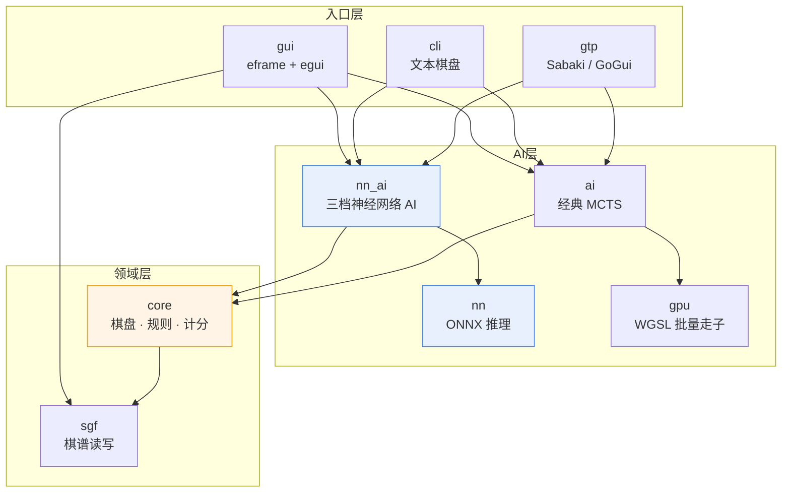
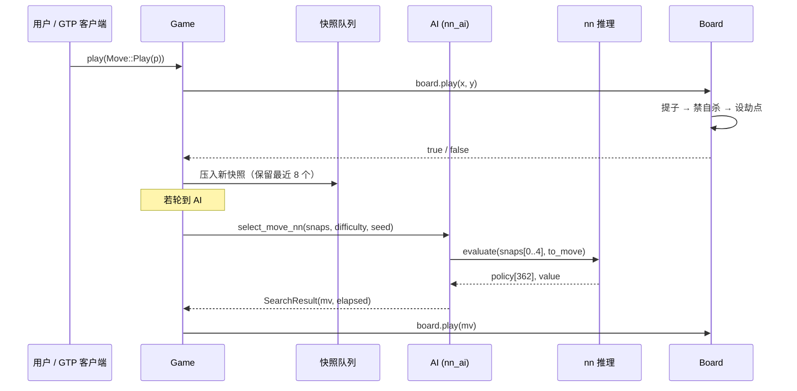
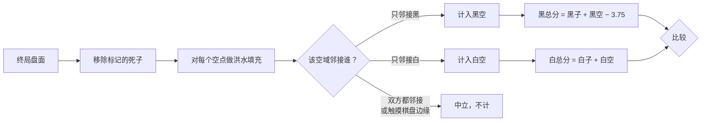
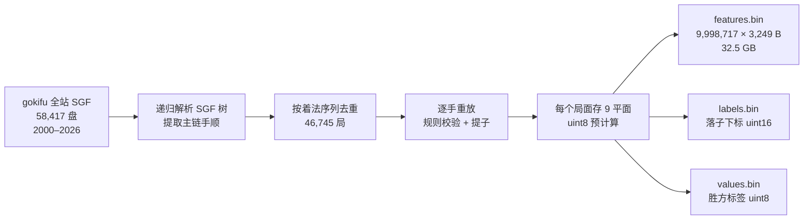
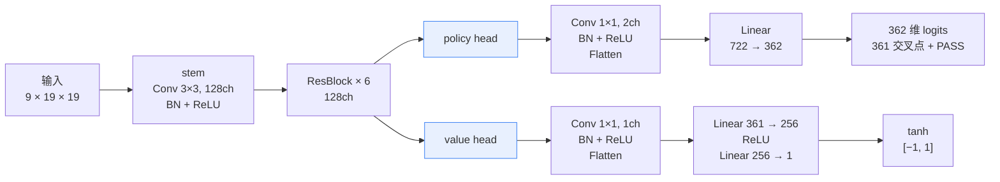
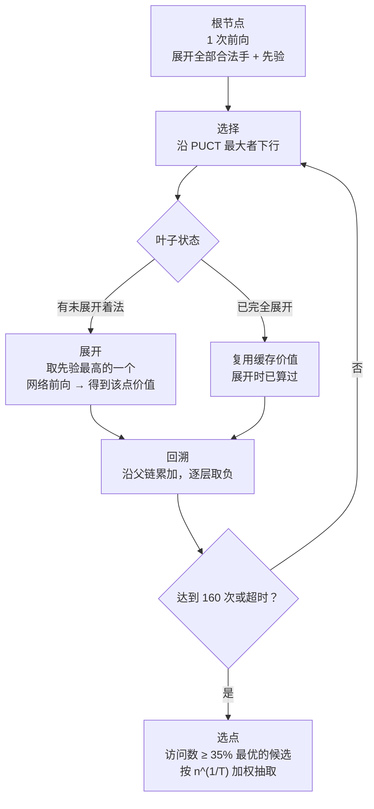

# GobanGo · 19 路围棋

一个用 Rust 写的围棋程序：19×19 棋盘、中国规则数子、GUI / 命令行 / GTP 三种入口，内置**神经网络 AI**（由 1000 万手人类棋谱训练）与经典 MCTS 引擎，支持低 / 中 / 高三档难度切换。

```
┌─ 纯 Rust 实现，无 Python / CUDA 运行时依赖
├─ 模型 8.2MB 编译期内嵌，发布物是一个 exe
├─ 单次网络前向 6–8ms，高档搜索 1.1s/步
└─ 42 项测试覆盖规则、推理对齐、GTP、难度梯度
```

---

## 目录

- [1. 快速开始](#1-快速开始)
- [2. 系统架构](#2-系统架构)
- [3. 规则实现](#3-规则实现)
- [4. 神经网络原理](#4-神经网络原理)
- [5. 搜索算法](#5-搜索算法)
- [6. 推理工程](#6-推理工程)
- [7. 接口](#7-接口)
- [8. 测试与实测数据](#8-测试与实测数据)
- [9. 文件清单](#9-文件清单)
- [10. 已知限制](#10-已知限制)

---

## 1. 快速开始

### 构建

```bash
cd gogame
cargo build --release
```

产物：`target/release/gobango.exe`（Windows）/ `target/release/gobango`（Linux、macOS），约 **35 MB**（含内嵌模型）。

首次构建要编译 244 个依赖 crate，实测 **2 分 20 秒**（依赖已缓存）；首次联网拉取依赖约 5–10 分钟。之后增量编译 10 秒内。

### 运行

```bash
gobango                                              # 启动 GUI
gobango --mode human_ai                              # 命令行人机对弈（默认神经网络·中档）
gobango --mode human_ai --engine nn --nn-difficulty high
gobango --mode ai_ai --engine nn --nn-difficulty low  # 观战
gobango --engine classic --difficulty 高级            # 切回经典引擎
gobango --gtp                                        # GTP 引擎
```

### 参数

| 参数 | 取值 | 说明 |
|------|------|------|
| `--mode` | `human_ai` / `ai_ai` / `human_human` | 对局模式，省略则启动 GUI |
| `--engine` | `nn` / `classic` | AI 引擎，默认 `nn` |
| `--nn-difficulty` | `low` / `medium` / `high`（也可 `低`/`中`/`高`、`1`/`2`/`3`） | 神经网络三档 |
| `--difficulty` | `入门` / `中级` / `高级` / `大师` | 经典引擎四档 |
| `--color` | `black` / `white` | 人机模式下玩家执子 |
| `--gtp` | — | 启动 GTP 协议引擎 |

模型加载失败时（文件损坏、架构不匹配、平台不支持），GUI / CLI / GTP **全部自动回退**到经典引擎，对局不中断。

---

## 2. 系统架构

### 2.1 分层



依赖是单向的：`入口 → AI → core`。`core` 不知道 AI 存在，因此规则可以被独立测试（`tests/stability.rs` 用几百局随机对局做压力验证）。

### 2.2 模块职责

| 模块 | 职责 |
|------|------|
| `core.rs` | 棋盘、棋链、提子、禁着、劫、对局状态、中国规则计分、局面快照队列 |
| `ai.rs` | 经典 MCTS：UCT / RAVE / GRAVE、3×3 模式走子、开局库、虚拟损失、四档配置 |
| `nn.rs` | ONNX 模型加载与推理，9 平面特征构造 |
| `nn_ai.rs` | 三档神经网络 AI：温度采样 + PUCT 树搜索 |
| `gpu.rs` | wgpu 批量随机走子（经典引擎的可选加速） |
| `gui.rs` | 棋盘绘制、交互、侧栏控制 |
| `cli.rs` | 命令行对局循环 |
| `gtp.rs` | GTP 2.0 协议子集 |
| `sgf.rs` | SGF 棋谱读写 |

### 2.3 一次落子的完整路径



快照队列（`Game.snaps`）是关键设计：神经网络输入需要**最近 4 个时刻的完整盘面**，而 GUI 每个渲染帧都可能触发 AI 决策，重放上百手棋来构造历史代价太高。落子时顺手压一份 `Board` 副本（百字节量级），取历史变成 O(1)。

---

## 3. 规则实现

### 3.1 棋盘表示

采用 **1D 数组 + 边界哨兵**：`grid: [Color; 21×21]`，外圈永远是不可落子的 `Empty`。

```
索引 = (y + 1) * 21 + (x + 1)
```

好处是邻居访问不需要做边界判断，直接 `idx ± 1` / `idx ± 21` 即可 —— 在 MCTS 里这会被执行上百万次。

配套字段：

| 字段 | 用途 |
|------|------|
| `stone_hash: u64` | Zobrist 哈希（仅棋子，不含回合），用于局面比较与去重 |
| `ko_point: Option<Point>` | 简单劫点 |
| `black_captures` / `white_captures` | 各方累计提子数 |
| `last_captured: u32` | 最近一手的提子数，供走子策略打分 |

`Board` 是 `Clone` 的普通结构体，MCTS 每个节点存一份完整盘面，省去重放。

### 3.2 提子：顺序决定对错

这是围棋实现里最容易写错、且错误最隐蔽的地方：

```rust
// ① 落子
self.set(x, y, color);

// ② 先找出所有无气的敌方棋链，并移除
for 邻居 in 四方向 {
    if 邻居是对方 && 该链气数 == 0 {
        remove_group(邻居);   // 立即移除
    }
}

// ③ 再算己方棋链的气
if count_liberties(x, y) == 0 {
    rollback(); return false;   // 真自杀
}
```

**顺序不能反。** 如果先算己方气、再提子，那么所有「靠吃掉对方而获得气」的合法手都会被误判成自杀：

- 打劫回提（提一子后自己有了气）
- 倒扑（送一子进去，提回对方一串）
- 对杀时的紧气手

这类手在职业棋谱里约占 **5–8%**。误判的后果是双向的：训练时这些手被当作非法丢弃，标签与局面错位（模型学的是错的东西）；对弈时引擎拒绝走合法手，直接输棋。训练工程与 `tests/nn.rs` 各有一组回归测试锁死这个行为。

### 3.3 劫

采用**简单劫**（simple ko）：只有当一手棋**恰好提掉对方 1 子**时，才把那个被提点设为 `ko_point`，下一手禁止立即回提。

```rust
if captured_total == 1 { ko_point = Some(被提位置) } else { ko_point = None }
```

这比 Zobrist 全局面比较更快，也足够覆盖实战中 99% 的劫争。代价是**三劫循环、长生劫**不会被检测（会走成无限循环），但家用对弈场景下不值得为它付复杂度。

### 3.4 计分

中国规则数子法，黑贴 3.75 子（7.5 目）。



死子自动判定（`auto_dead_points`）用真眼法：棋链气数 ≤ 2 时，检查其气点是否构成真眼；一个真眼都没有则判死。该方法对简单死棋有效，对双活、劫活会误判 —— 所以 GUI 保留了手动标记接口，用户可以纠正。

---

## 4. 神经网络原理

### 4.1 从棋谱到监督学习

围棋的监督学习任务很直接：**给一个局面，预测人类会下在哪里**，顺带预测**这盘谁赢**。



**去重**：站点上同一盘棋有中英文两个页面，按「着法序列」哈希去重，58,417 → 46,745。

**样本定义**（一手棋 = 一个样本）：

| 项 | 内容 |
|---|---|
| 输入 | 该手落下**之前**的局面 + 前 3 个时刻的历史 |
| policy 标签 | 这一手实际落点（0..360），或 361 表示 PASS |
| value 标签 | 终局胜方。`1` = 黑胜，`0` = 白胜，`255` = 未知（约 10% 棋谱缺 `RE[]`） |

**为什么预先算好 uint8**：9 平面 × 361 点 = 3,249 字节，10M 样本 = 32.5GB。如果存 SGF、训练时再重放，每个 epoch 都要重跑一遍规则引擎，比 GPU 计算慢几个数量级。预计算 + `memmap` 顺序读，才能把 GPU 喂饱。

### 4.2 输入特征：9 个平面

```
通道 0–3   最近 4 个时刻的「己方棋子」      (1 = 有己方子)
通道 4–7   同一批时刻的「对手棋子」          (1 = 有对手子)
通道 8     常数平面：轮到白方 = 1，黑方 = 0
```

历史不足 4 个时刻时补全零平面（开局前几手）。

**两个刻意的设计选择：**

1. **存全盘布局，不存落点。** 早期版本用「最近 8 手的坐标」做输入，价值头完全学不动（loss 恒为 1.0）。原因很清楚：8 个坐标无法还原盘面，网络看不到棋子的连通与厚薄，而这正是判断形势的全部依据。

2. **必须有常数平面。** 围棋有贴目（黑要净胜 7.5 目），所以「当前行棋方最终会不会赢」依赖**绝对颜色**。若特征全是相对视角（己方/对手），网络无法区分「轮到黑」和「轮到白」，价值头只能输出一个常数。实测加上这个平面后，value 准确率立刻从 50%（随机水平）升到 63%。

### 4.3 网络结构



每个 `ResBlock`：`Conv3×3 → BN → ReLU → Conv3×3 → BN → +skip → ReLU`。

总计 **2.14M 参数**，8.2MB。这是个刻意压小的网络：目标是家用 CPU 上实时推理，而不是追求最强棋力。参考量级 —— AlphaGo 的 policy 网络 2800 万参数，KataGo 上百 MB。6 个残差块的理论感受野约 27 路，足以覆盖全盘。

**value 的含义**：输出**当前行棋方**的胜率倾向，`+1` = 必胜，`−1` = 必败。这个约定让同一个网络既能评黑也能评白，不用切换视角。

### 4.4 双目标损失

```python
p_loss = CrossEntropy(logits, move_label)          # 361 + PASS 分类
v_loss = MSE(value, ±1)                            # 回归
loss   = p_loss + 0.5 * v_loss
```

工程设置：

| 项 | 设置 | 原因 |
|---|---|---|
| 数据增强 | 棋盘 8 种对称变换 | 围棋规则在旋转/镜像下不变，等于数据量 ×8 |
| 标签平滑 | 0.05 | 人类棋谱里有大量「同等好」的选点，硬标签过于自信 |
| 优化器 | AdamW，lr 1e-3，cosine 退火 | |
| 混合精度 | AMP | 吞吐提升约 1.8× |
| batch | 512 | |
| value 权重 | 0.5 | policy 梯度量级更大，不降权会让价值头学得慢 |

### 4.5 训练结果

8 轮，约 5 小时，RTX 5060 Ti。

| epoch | policy_loss | value_loss | top-1 | top-5 | value 准确率 |
|---|---|---|---|---|---|
| 1 | 3.3039 | 0.8676 | 31.4% | 64.8% | 56.0% |
| 4 | 2.8511 | 0.6982 | 34.7% | 69.4% | 61.8% |
| **8** | **2.7425** | 0.6886 | **36.3%** | **71.1%** | **63.6%** |

三个指标到最后一轮仍在上升，说明**没有过拟合，加数据/加轮数还有收益**。

这些数字的含义：

- **top-1 = 36.3%**：给定局面，网络第一选点与人类棋手完全一致的概率。参照：纯随机 0.3%，人类高段棋手之间约 40–50%。这个水平大致相当于业余中段。
- **top-5 = 71.1%**：人类实际落点落在网络前 5 选之内的概率。
- **value 准确率 63.6%**：只看局面判断最终胜负的准确率。围棋胜负常在中后盘才明朗，63% 是能用的水平。

---

## 5. 搜索算法

### 5.1 三档难度是怎么来的

一个常见误区是「模拟次数越多越强」。实测恰恰相反：**策略准确率只有 36% 时，深搜索是负收益**。

| 对照实验（同一权重） | 结果 |
|---|---|
| 纯策略 vs MCTS 160 sims（价值头估值） | MCTS 胜 |
| 纯策略 vs MCTS 400 sims | 纯策略胜 |
| 纯策略 vs MCTS + 随机 rollout | 纯策略胜 |

原因：PUCT 用网络先验作为探索的分配依据。先验本身噪声大时，搜索会**放大**偏差而不是修正它；价值头的估值误差经多次累加也会劣化决策。所以模拟次数必须控制在网络质量配得上的范围内。

三档因此是**温度 + 搜索**的组合，而不是单纯堆算力：

| 档位 | 搜索 | 选点方式 | 模拟数 | 单步 |
|---|---|---|---|---|
| **低** | 无 | top-5，温度 T = 2.0 | 0 | ~7ms |
| **中** | 无 | top-12，温度 T = 0.9 | 0 | ~7ms |
| **高** | PUCT | 访问数 ≥ 35% 最优者中加权，T = 0.25 | 160 | ~1.1s |

低/中档**刻意保留随机性** —— 只有会犯错，才谈得上难度。低档的高温采样让它几乎均匀地在 5 个候选里挑，经常下出明显次优手；中档 T = 0.9 基本贴合网络首选，偶尔偏移。

### 5.2 纯策略采样（低 / 中档）


关键在最后一步：**不是取 argmax，而是按温度加权采样**。`T → 0` 退化为贪心，`T = 1` 保持原分布，`T > 1` 趋于均匀。低档 `T = 2.0` 意味着次优点的权重被显著抬高。

`top-k` 截断是为了克制「盲目乱走」—— 如果网络给某个明显糟糕的点很小的概率，高温采样也可能选中它，那就不是「弱」而是「蠢」了。

### 5.3 PUCT 树搜索（高档）



**选择公式（PUCT）**：

```
score(c) = Q(c) + c_puct × P(c) × √N(parent) / (1 + N(c))

  Q(c)     = −W(c) / N(c)        ← 注意负号
  W(c)     = 子节点累积价值，子节点行棋方视角
  P(c)     = 网络给这手的先验概率
  c_puct   = 1.6
```

`Q` 取负号是因为**视角交替**：子节点的 `W` 记的是「轮到对方走时对方的价值」，换回父节点视角必须取反。同理回溯时逐层取负：

```rust
fn backprop(&mut self, leaf: usize, leaf_value: f32) {
    let mut v = leaf_value as f64;
    let mut cur = Some(leaf);
    while let Some(i) = cur {
        self.nodes[i].n += 1;
        self.nodes[i].w += v;
        v = -v;                        // 上一层行棋方相反
        cur = self.nodes[i].parent;
    }
}
```

**为什么展开时就算价值**：树搜索的瓶颈是前向次数。每个新节点展开时做一次前向，把 policy 用作子节点先验、把 value 缓存下来；之后该节点被重复访问时直接用缓存值回溯，不再推理。160 次模拟只需约 160 次前向，而非 2 倍。

**历史快照怎么来**：树中每个节点存了完整 `Board`，所以某节点的「最近 4 个时刻」可以沿 parent 链直接取到，不够就用根节点之前的真实历史补齐：

```rust
fn snaps_for(&self, parent: usize, b: &Board) -> Vec<Board> {
    let mut out = vec![b.clone()];
    let mut cur = Some(parent);
    while let Some(i) = cur {
        if out.len() >= HISTORY { break; }
        out.push(self.nodes[i].board.clone());
        cur = self.nodes[i].parent;
    }
    // 补齐根之前的真实历史
    for b2 in self.root_snaps.iter().skip(1) { /* ... */ }
    out
}
```

**选点不取 argmax**：搜索结束后，只在「访问数 ≥ 最优者 35%」的候选里按 `n^(1/T)` 加权抽一个。纯 argmax 会让同一局面永远只走一手，缺少变化；加一点温度既保持强度又增加多样性。

### 5.4 经典引擎（对照组）

`ai.rs` 是一个完整的传统 MCTS，作为神经网络的对照与降级方案：

| 技术 | 作用 |
|---|---|
| UCT | 基础选择公式，`Q + c·√(ln N / n)` |
| RAVE / AMAF | 用「这手在任何分支下出现过」的统计加速早期评估 |
| 3×3 模式走子 | 用局部棋形库指导随机走子（Pachi / Fuego 风格），相比纯随机强度提升显著 |
| 虚拟损失 | 多线程并行时给正在展开的着法加负偏置，避免线程撞车 |
| 虚拟走子 | 叶子无可展开时直接用父节点胜率，省掉一次空 rollout |
| 开局库 | 内置标准布局，前 10–50 手直接查表 |
| GPU 批量走子 | wgpu 计算着色器一次跑 1024 局随机对局，无 GPU 时回退 CPU |

四档参数（`Difficulty::config()`）：

| 档位 | 时间 | 模拟上限 | 线程 | 走子策略 | 开局库 |
|---|---|---|---|---|---|
| 入门 | 0.5s | 500 | 1 | 随机 + 过滤 | 无 |
| 中级 | 2.0s | 3,000 | 2 | 启发式 | 前 10 手 |
| 高级 | 5.0s | 20,000 | 4 | 强启发式 + 模式 | 前 50 手 |
| 大师 | 60s | 5,000,000 | 8–16 | 同上 + 战术验证 | 前 50 手 |

---

## 6. 推理工程

### 6.1 选型

要在 Rust 里跑 PyTorch 训练的模型，候选方案：

| 方案 | 评价 |
|---|---|
| `tch`（绑定 libtorch） | 要分发 ~2GB 动态库，部署灾难 |
| `onnxruntime`（绑定 C++ 库） | 要分发 ~15MB dll 和平台相关二进制 |
| **`tract-onnx`（纯 Rust）** | **无外部依赖，静态链接进 exe，选它** |

实测 tract 的 SIMD 优化相当好：**6–8.6ms/次前向**。这个数字是整套设计的前提 —— 如果前向要 50ms，160 次模拟就是 8 秒/步，PUCT 搜索根本不可行，只能退化成「网络当启发式用」。

### 6.2 内嵌与加载

```rust
// src/nn.rs
static EMBEDDED_MODEL: &[u8] = include_bytes!("../assets/policy_value.onnx");
```

模型在**编译期**写进二进制，运行时零文件依赖。`assets/policy_value.onnx`（8.2MB）是唯一的构建期资源。

加载走 `OnceLock`，全局只初始化一次：

```rust
static ENGINE: OnceLock<Option<Mutex<Engine>>> = OnceLock::new();
```

`Option` 表示「尝试加载过但失败了」—— 每次调用不会重复失败重试，`is_ready()` 直接用这个结果做降级判断。`nn::init(Some(path))` 支持外部模型热替换（便于升级权重），失败则回退内嵌版本。

### 6.3 特征对齐：差一位就全废

这是整个集成里最危险的一步。训练输入是 PyTorch 里构造的 9 平面张量，推理输入是 Rust 里手工填的数组 —— **任何下标错位，权重都会变成噪声**，而且不会报错，只表现为「AI 下得很奇怪」。

对齐规则：

```
arr[i][y][x]           = 己方子（第 i 个历史时刻）
arr[HISTORY + i][y][x] = 对手子（同一时刻）
arr[2*HISTORY][y][x]   = 常数（轮到白 = 1）
```

其中 `y` = 行、`x` = 列，对应 Python 的 `grid[y][x]`；而项目内部 `Point.x` = 列、`Point.y` = 行，两者是**转置关系**，这是最容易踩的坑。

验证方法：同一局面（30 手）分别走 Rust 与 PyTorch，逐位比对。

```
特征差异        0 处
policy 最大误差  8.11e-06
value  最大误差  2.37e-07
```

误差来自 f32 累加顺序差异，量级 1e-6 完全正常。该检查保留为 `examples/nn_check.rs`，改特征代码后必须重跑。

### 6.4 性能

| 操作 | 耗时 |
|---|---|
| 单次前向（batch=1，9×19×19） | 6.0–8.6ms |
| 合法着法枚举（全盘扫描） | < 130µs |
| 低/中档一步（1 次前向 + 采样） | ~7ms |
| 高档一步（160 次模拟） | ~1.1s |
| 完整一局（约 500 手，高档 vs 中档） | ~8 分钟 |

前向是绝对瓶颈，占总耗时 95% 以上。优化方向明确：**批量推理**（把同层多个叶子合成一个 batch），能把高档再快 2–3 倍。

---

## 7. 接口

### 7.1 CLI

```bash
gobango --mode human_ai --engine nn --nn-difficulty high --color black
```

输入坐标（`Q16`、`D4`），`pass` 虚着，`undo` 悔棋，`quit` 退出。

### 7.2 GTP

标准 GTP 2.0 子集，可直接接入 Sabaki、GoGui、Lizzie。

| 命令 | 说明 |
|------|------|
| `boardsize` / `clear_board` / `komi` | 基础设置 |
| `play B D4` / `genmove W` | 落子 / 生成着法 |
| `undo` / `showboard` / `final_score` | 悔棋 / 显示 / 计分 |
| `list_commands` / `known_command` | 能力查询 |
| **`goban_difficulty low\|medium\|high`** | 切到神经网络对应档位 |
| **`goban_difficulty 入门\|中级\|高级\|大师`** | 切到经典引擎对应档位 |

```bash
$ printf 'goban_difficulty high\ngenmove black\n' | gobango --gtp
= D16
```

### 7.3 GUI

侧栏两个选择器：**AI 引擎**（神经网络 / 经典）与**难度**（低 / 中 / 高）。切换时自动取消正在进行的搜索。

其余：悔棋、虚着、认输、标记死子、计分确认、SGF 存档/读取。

---

## 8. 测试与实测数据

### 8.1 测试覆盖

`cargo test --release` → **42 项全部通过**。

| 文件 | 覆盖 |
|---|---|
| `tests/ai.rs` | 经典引擎合法性、开局库、难度配置 |
| `tests/gtp.rs` | GTP 命令序列、错误响应格式 |
| `tests/perf.rs` | 各难度单步耗时预算 |
| `tests/stability.rs` | 长时间随机对局，内存与状态稳定 |
| `tests/nn.rs` | 推理可用、特征形状、快照队列、悔棋后快照重建、三档出招合法 |

### 8.2 难度梯度（自对弈实测）

难度不是拍脑袋定的，用项目自带的中国规则数子法判胜负：

| 对阵 | 结果 | 说明 |
|---|---|---|
| 中 vs 低 | **9 : 1**（90%） | 温度梯度有效 |
| 高 vs 中 | **2 : 0** | 执黑执白各胜一局，搜索有效 |

复现：

```bash
cargo run --release --example nn_match -- medium low 10
cargo run --release --example nn_match -- high medium 2
```

### 8.3 修复的两个既有 bug

集成过程中发现原代码有两处真实缺陷：

**1. GTP 响应错位。** `goban_difficulty` 分支用了 `return`，绕过了 `handle()` 末尾统一加前缀（`=` 或 `?`）的逻辑，客户端收到的响应会整体偏移一位，导致后续所有命令解析错位。

**2. `parse_color` 不认 `black` / `white`。** 只认 `B`/`b`/`W`/`w`，而 Sabaki 发的是 `genmove black`，引擎直接回 `? invalid color` —— 意味着原来的 GTP 引擎其实接不上 Sabaki。

---

## 9. 文件清单

### 9.1 最小可运行集（上传用）

共 **17 个文件，8.6 MB**（其中模型占 8.2 MB）：

```
gogame/
├── Cargo.toml                        必需  依赖声明
├── Cargo.lock                        必需  锁定依赖版本
├── readme.md                         必需  本文档
├── assets/
│   └── policy_value.onnx             必需  模型权重，include_bytes! 内嵌
├── data/
│   └── opening_book.txt              可选  自定义开局库（0.6KB，缺失则用内置）
└── src/
    ├── main.rs                       必需  入口与参数解析
    ├── lib.rs                        必需  模块声明
    ├── core.rs                       必需  棋盘 · 规则 · 计分
    ├── ai.rs                         必需  经典 MCTS 引擎
    ├── nn.rs                         必需  ONNX 推理 + 特征构造
    ├── nn_ai.rs                      必需  三档神经网络 AI
    ├── gpu.rs                        必需  wgpu 批量走子（经典引擎加速）
    ├── gpu_playout.wgsl              必需  着色器，被 include_str! 引用
    ├── gtp.rs                        必需  GTP 协议
    ├── cli.rs                        必需  命令行对局
    ├── gui.rs                        必需  GUI
    └── sgf.rs                        必需  SGF 读写
```

> `src/gpu_playout.wgsl` 和 `assets/policy_value.onnx` **不能删** —— 它们通过 `include_str!` / `include_bytes!` 在编译期被读入，缺失会直接编译失败。

### 9.2 可删（不在最小集内）

| 路径 | 大小 | 说明 |
|------|------|------|
| `target/` | 数 GB | 编译产物，重新构建即可 |
| `tests/` | 28KB | 测试代码，不影响运行 |
| `examples/` | 15KB | 基准与验证工具（`nn_check` / `nn_match` / `nn_bench` / `nn_perf` / `nn_smoke`） |
| `src.zip` | 6KB | 历史遗留压缩包 |
| `*.exe`（非 gobango） | 30MB | 与本项目无关的残留文件 |

> `tests/` 和 `examples/` 虽可删，但**建议保留 `examples/nn_check.rs`** —— 修改特征构造代码后，必须用它重新验证与训练端的一致性。

### 9.3 精简步骤

```bash
# 1. 新建干净目录，只复制最小集
mkdir -p gogame-min/src gogame-min/assets gogame-min/data
cp Cargo.toml Cargo.lock readme.md gogame-min/
cp src/*.rs src/gpu_playout.wgsl gogame-min/src/
cp assets/policy_value.onnx gogame-min/assets/
cp data/opening_book.txt gogame-min/data/

# 2. 验证可独立编译（实测 244 个 crate，2 分 20 秒）
cd gogame-min && cargo build --release

# 3. 验证可运行
./target/release/gobango --mode ai_ai --engine nn --nn-difficulty low
```

> 本节的最小集已在干净目录实测验证：`cargo build --release` 零错误通过，产物 35 MB，可正常对弈。

---

## 10. 已知限制

**棋力上限。** policy top-1 36.3% 大致是业余中段水平，比经典引擎的启发式走子更「像人」（棋形更自然、不那么机械），但绝对棋力不算强。想提升应该**继续加强网络**（更大网络、更多数据、更多轮数、加入自我对弈强化学习），而不是堆模拟次数 —— 5.1 节的实验已经证明后者是负收益。

**高档速度。** 1.1s/步，一局约 8 分钟。瓶颈是逐节点单样本前向，改成批量推理可提速 2–3 倍。

**劫的处理。** 只实现简单劫，三劫循环 / 长生劫不会被检测。

**死子判定。** 自动真眼法对双活、劫活会误判，需手动标记纠正。

**GUI 交互验证。** 引擎切换与难度选择器的代码已完成并通过编译，但未做点击级自动化验证（窗口交互无法脚本化），实际使用中如遇异常请反馈。

---

## 附：训练工程

模型训练代码在独立目录（Python + PyTorch），与对弈程序解耦：

| 文件 | 职责 |
|---|---|
| `go_rules.py` | 规则引擎（与 Rust 端行为必须一致） |
| `sgf_dataset.py` | SGF → 9 平面特征 + policy/value 标签 |
| `model.py` | 双头残差网络定义 |
| `train.py` | 训练主循环（AMP、8 对称增强、分块顺序读） |
| `go_engine.py` | 对弈 / GTP，用于验证训练效果 |

迁移到本项目的完整流程：

```
1. 修改 model.py 结构 → 重训 → 导出 ONNX（opset 17）
2. 覆盖 assets/policy_value.onnx
3. cargo build --release
4. cargo run --release --example nn_check              ← 必须做，验证特征对齐
5. cargo run --release --example nn_match high medium 10   ← 验证棋力梯度
```

只要输入特征的**平面数、顺序、坐标朝向**不变，`src/nn.rs` 与 `src/nn_ai.rs` 无需改动。
